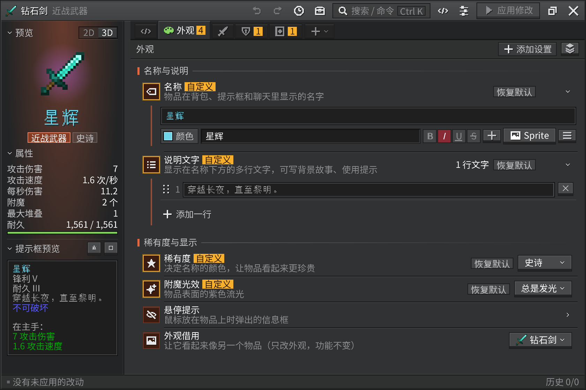
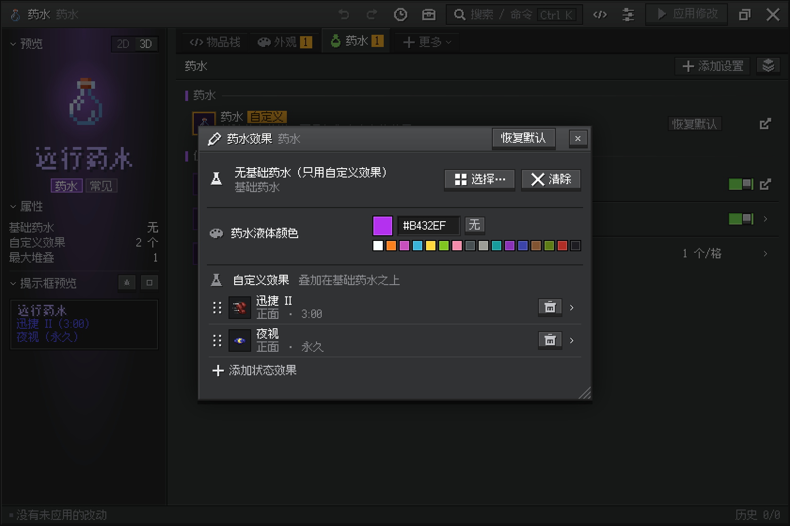
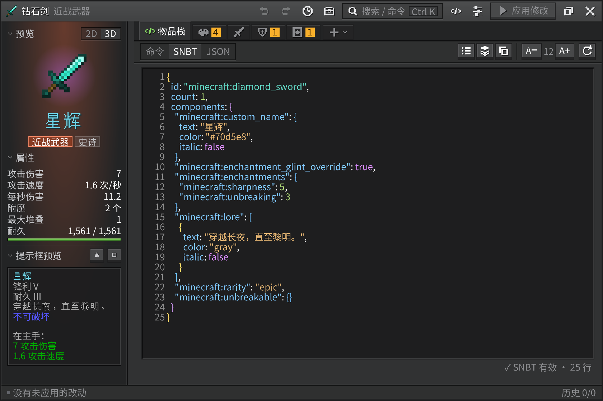

<p align="center">
  
</p>

# CAD Editor · Recast

Minecraft 物品数据组件编辑器：游戏里按 **I**（或 `/cade`）打开可视化界面：悬停 / 手持物品改物品，对着方块、实体、玩家改它们，什么都不指就改自己。

CAD Editor（Component And Data Editor）的换代重写，界面基于 [Oriel UI](https://github.com/Rinorsi/Oriel-UI)。
**预发布 0.99.x**：功能补全之前不进入 1.0，清单见 [`docs/COVERAGE.md`](docs/COVERAGE.md)。

## 界面预览

改名称、说明和外观时，左侧同步预览物品与提示框。



<details>
<summary>药水效果：调整效果、等级与持续时间</summary>



</details>

<details>
<summary>SNBT 编辑：语法高亮、行号与格式化</summary>



</details>

以上为 0.99.7 源码页面的离线预览，使用演示数据。[截图说明](docs/screenshots/README.md)

## 能改什么

- **物品**：运行版本的全部持久数据组件（26.1.2 / 26.2 / 26.3 分别为 107 / 108 / 119 个原版组件，另支持模组注册的组件）；刷怪蛋 / 刷怪笼（生物外观、体型、属性、状态效果、装备）；提示框预览用游戏自己生成的内容。数值范围来自游戏的真实 Codec，不是手写表。
- **世界里已放置的东西**（对准它按 **I**，或 `/cadeditor block|entity|player`）：方块实体（容器、告示牌、旗帜、蜂箱、讲台、唱片机、陶罐、命令方块、头颅、熔炉 / 酿造台 / 营火的进度……）、方块状态；实体（姿态、装备、属性、展示框 / 画、展示实体、村民交易、乘客）。
- **保险库**（按 **O**，主菜单 / 暂停菜单也有按钮）：把改好的物品存在本机，之后取出放进任意物品槽或字段。

按键都在“控制”设置里的“CAD Editor”分类，可以改：编辑 = I，保险库 = O。按住 Shift 再按 I：只改手里的物品，空手就改自己。

当前版本：<!-- editor-version -->0.99.7<!-- /editor-version --> · [更新日志](CHANGELOG.md) · [发版清单](docs/RELEASE.md)

高级多行编辑、特殊浮点数、背包格完整编辑及窗口缩放设置见[操作说明](docs/EDITOR-INTERACTION.md)；出错定位见[写回日志](docs/INVENTORY-WRITE-DIAGNOSTICS.md)。

## 下载

从本仓库 GitHub **Releases** 获取附件；尚未公开的版本以维护者本地分发为准。每版提供六个 jar 与 `SHA256SUMS.txt`，只安装一个匹配目标的 jar。Modrinth / CurseForge 项目待维护者填写 ID 后启用。

## 支持的版本

| Minecraft | Fabric | NeoForge | Java / 前置 |
|---|---|---|---|
| 26.1.2 | `cadeditor-fabric-26.1.2-<版本>.jar` | `cadeditor-neoforge-26.1.2-<版本>.jar` | Java 25 / 已内嵌 Oriel UI 0.15.0 |
| 26.2 | `cadeditor-fabric-26.2-<版本>.jar` | `cadeditor-neoforge-26.2-<版本>.jar` | 同上 |
| 26.3 | `cadeditor-fabric-26.3-<版本>.jar` | `cadeditor-neoforge-26.3-<版本>.jar` | 同上 |

## 要求

Minecraft 26.1.2 / 26.2 / 26.3 · Fabric 或 NeoForge · Java 25 · **对应版本的 Oriel UI 0.15.0（正式包已内嵌）**。Fabric 需 Loader ≥ 0.19.5 与匹配游戏版本的 Fabric API。

## 安装

**客户端必装，服务端选装。** 房主未安装时仍可连接；完整服务端编辑能力需要房主安装并授权。

`mods/` 里放 与加载器及游戏版本匹配的 CAD Editor；正式包内嵌 Oriel 0.15.0，无需另装 Oriel，Fabric 还需 Fabric API。创造模式保留原版写回。服务端未装本模组时，获得原版 execute/item 命令权限的生存玩家也可修改自己的普通背包 0..35（第1～36格）；主手绑定打开时的槽位，装备、副手、容器及世界/其他玩家仍需服务端模组；有原版命令权限也可从本地保险库取出到自己的空槽。命令写回只在收到服务器同步后确认成功，部分匹配保护不等于完整 CAS；少量原版反馈可能通知本人、其他 OP 并记录控制台，不向普通非 OP 玩家广播，插件额外转发未知。详见[能力与限制](docs/client-only-hotbar.md)。

| 安装位置 | 必需文件 |
|---|---|
| 客户端 `mods/` | 一个匹配目标的 CAD Editor jar（内含 Oriel）；Fabric 另放 Fabric API |
| 需要完整编辑能力的服务器 `mods/`（选装） | 相同游戏版本与加载器的 CAD Editor（内含 Oriel）和对应依赖；管理员授予写入权限 |

房主选择安装完整后端时，还需考虑 Oriel 的客户端前置要求：Fabric 26.1.2 / Oriel 0.11 实测中，未安装 Oriel 的旁观客户端会因缺少 `oriel` 注册表项被拒绝连接。此时其他玩家也应安装匹配的 Oriel；这与“房主完全不装 Editor/Oriel、操作者仅在客户端安装”的场景不同，后者已完成真实 LAN 库存/Vault 验证。其他版本和加载器的这一连接组合尚未实测。

只在客户端安装时，本机保险库的保存、整理、导入导出可正常使用，不要求 OP。服务器授予原版权威查询及对应命令权限后，可逐项修改自己的游戏模式、经验等级、本等级整数点数、同维度位置/旋转，以及一个可同步属性的基础值；每笔只发送一条修改命令，服务器回读确认后才算保存。本级点数不设置累计经验；位置不跨维度；属性必须存在服务器原始 base，修饰符不随之覆盖。生命、饥饿、独立能力、完整重生配置等仍提示需要服务端 Editor，不能混入命令提交。完整自身/其他玩家、容器及世界编辑需要服务端安装并授权。详见[自身命令合同](docs/self-player-command-contract.md)和[扩展字段合同与验收范围](docs/self-player-next-contract.md)。

没有原版命令权限的生存玩家可编辑本地草稿和管理保险库，游戏数据不会因此改变；界面会持续提示权限或服务端要求。只有收到服务器确认才显示保存成功；超时显示结果未知、保留草稿且不自动重发，应关闭后重新读取核对。

“保留草稿”指仍存在的编辑会话，不保证断线重连后自动恢复旧草稿。真实重连测试中新页面重新读取服务器已生效的值，旧连接的迟到回包不会在新页面报保存成功或触发重发；断线后的修改状态请重新读取核对。

## 从源码构建

**1. 仓库放在哪**

构建输出、运行目录、日志、截图都不在仓库里，而在同级的 `Oriel-UI-Workspace/daily/` 下，所以请这样摆：

```
Mods/
├── CAD-Editor-Recast/      ← 本仓库
├── Oriel-UI/               ← Oriel 源码仓库（只有跑预览 / 截图工具时才需要）
└── Oriel-UI-Workspace/     ← 工作区（不是仓库）
```

**2. 准备**

- JDK 25、Git Bash、Node.js 18+
- 获取 Oriel 0.15.0 六目标瘦包的 Maven 工件，使用 `-PorielRepository=<本地Maven目录>`，或放入 `libs/oriel-maven/`，也可在 Oriel 工程运行 `publishToMavenLocal -Poriel_slim`。不要把完整版作为嵌入依赖。

| 目标 | 命令 |
|---|---|
| 单目标与检查 | `./gradlew :fabric:26.1:build :fabric:26.1:check -PmcTest=false` |
| 六目标与检查 | `./gradlew build -PmcTest=false` |
| 本地发行目录（六 jar + SHA256） | `pwsh -File tools/build-all.ps1` |
| 版本同步预览 | `pwsh -File tools/bump-version.ps1 -Version <新版本> -DryRun` |

**3. 常用命令**（Git Bash，仓库根目录）

```bash
bash tools/gw.sh :fabric:26.1:build --no-problems-report   # 构建
bash tools/gw.sh build -PmcTest=false                       # 六目标构建与 JVM 检查
# PowerShell: pwsh -File tools/build-all.ps1                  # 六 jar + SHA256SUMS
node tools/ui-contract-test.cjs                              # 界面测试（另有 ui-world-test / ui-compact-test）
```

正式发行默认 `-PorielEmbedded=true`；外部依赖版用 `-PorielEmbedded=false`，该版需玩家另装 Oriel 0.15.x（低于 0.16）。两种模式均保留模组内部的 Oriel 必需依赖范围。嵌入版仍依赖 Oriel 的代码，只是玩家不需要另找一个文件；不修改 Oriel mod id 或做私有重定位。

调试游戏：双击 `启动物品工坊预览.bat`，保存 CSS / JS 即可热更新。

## 文档

世界编辑：[协议](docs/world-edit-contract.md) · [方块](docs/world-block-edit.md) · [实体](docs/world-entity-contract.md)。组件结构：[component-schema](docs/component-schema-contract.md)；保险库：[vault](docs/vault-contract.md)；验收：[docs/acceptance](docs/acceptance/)。

宿主搜索：[源码调研与性能](docs/search-architecture.md) · [search消息契约](docs/search-contract.md)。搜索架构参考 [JEI](https://github.com/mezz/JustEnoughItems)、[REI](https://github.com/shedaniel/RoughlyEnoughItems)、[EMI](https://github.com/emilyploszaj/emi) 的索引、缓存与可见网格思路，采用自主实现，未复制其代码；版本与文件许可见调研报告。

[`DEVELOPMENT`](docs/DEVELOPMENT.md) 开发说明 · [`README-host`](README-host.md) 宿主与写回合同 · [`registry-contract`](docs/registry-contract.md) 数据通道 · [`TESTING`](docs/TESTING.md) 测试 · [`COVERAGE`](docs/COVERAGE.md) 覆盖与 1.0 门槛

## 致谢

[Vellum](https://modrinth.com/mod/vellum-gui)（Max Leiter，MIT）：Oriel UI 基于它，界面引擎的思路也来自它。

## 许可

本项目原创代码采用 [MIT 许可证](LICENSE)。第三方组件仍遵循各自许可证，声明见 [`NOTICE`](NOTICE)。
